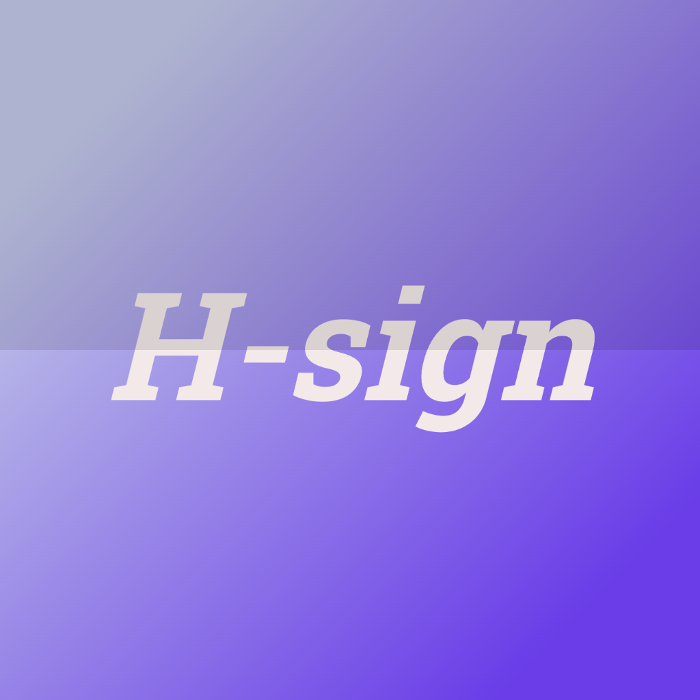

  

<h1 align="center">H-sign</h1>

  

<h1 align="center">H-sign</h1>

  <strong>Powerful on-device IPA signing and installation tool for iOS.</strong>

  
  
  

---

## 📱 About H-sign

**H-sign** is a custom fork of Ksign, completely redesigned and optimized for modern iOS versions. It allows you to sign and install `.ipa` files directly on your iPhone without needing a computer. 

We removed all the unnecessary bloat, fixed the bugs, and translated the interface into Russian.

## ✨ Features

- **On-Device Signing:** Import your own certificates (`.p12` and `.mobileprovision`) and sign apps right on your phone.
- **Semi-Local Installation:** Native support for the "Semi-Local" install method, which works flawlessly on iOS 18 and iOS 27.
- **Clean Interface:** No pop-ups, no donation banners, no crypto ads. Just a clean, translated UI.
- **Quick Links:** Built-in shortcuts to download AltStore, Scarlet, ESign, and visit our official website.
- **Full Russian Localization:** The entire UI is translated for Russian-speaking users.

## 🚀 How to Install

1. **Download** the latest `.ipa` file from the [Releases](https://github.com/elewenwl/HsignE/releases) page.
2. **Sign** the app using Sideloadly, AltStore, or ESign with your certificate.
3. **Open** H-sign and import your certificate (`.p12` + `.mobileprovision`).
4. **Import** any `.ipa` file you want to sign and install it using the **Semi-Local** method.

> ⚠️ **Note for iOS 27 Users:** The standard "Local" installation method may hang or fail due to Apple's security patches. Always use the **Semi-Local** method in the settings.

## 🛠️ Build from Source

This project is built using GitHub Actions. To compile your own version:
1. Fork this repository.
2. Enable GitHub Actions in the "Actions" tab.
3. Run the `Beta Build` workflow to generate an unsigned `.ipa`.

## 👨‍💻 Developer

**elevenvl (hybr1der)**
- Telegram Channel: [@Hsign_com](https://t.me/Hsign_com)
- Telegram Contact: [@to_el_day](https://t.me/to_el_day)
- Website: [elevenvl-tools](https://sfkumuxib.github.io/elevenvl-tools/)

## 🙏 Acknowledgements

This project is based on the original [Ksign](https://github.com/Nyasami/Ksign) and [Feather](https://github.com/claration/Feather) projects. Huge thanks to the original developers for their incredible work.

---

  <i>Made with ❤️ by elevenvl</i>

